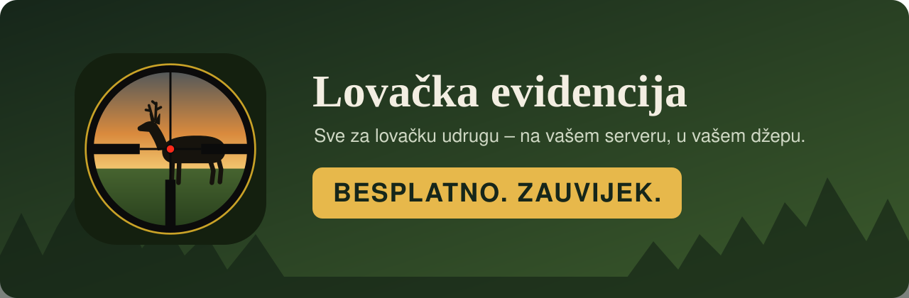
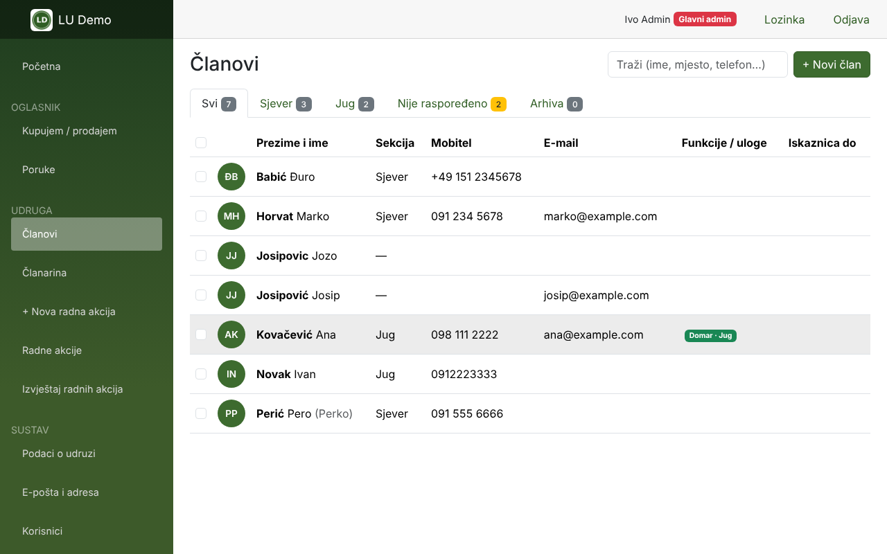
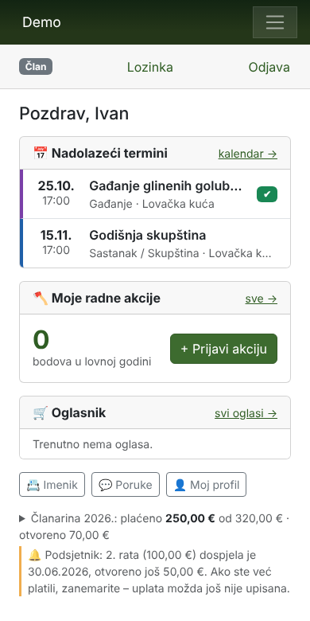
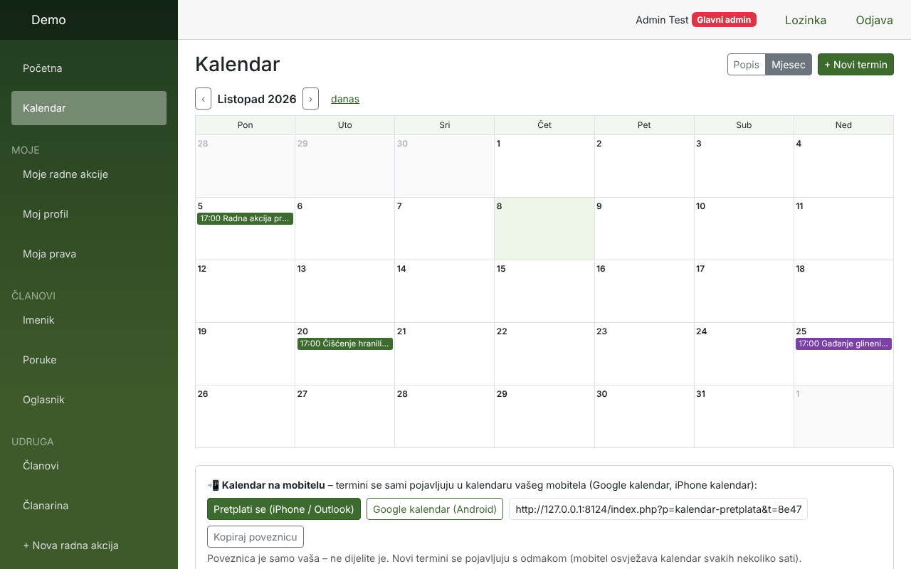
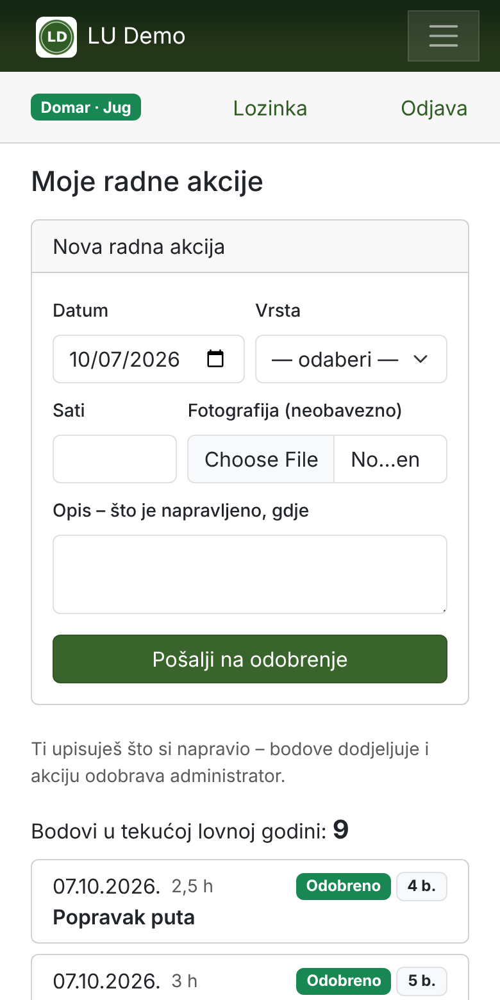
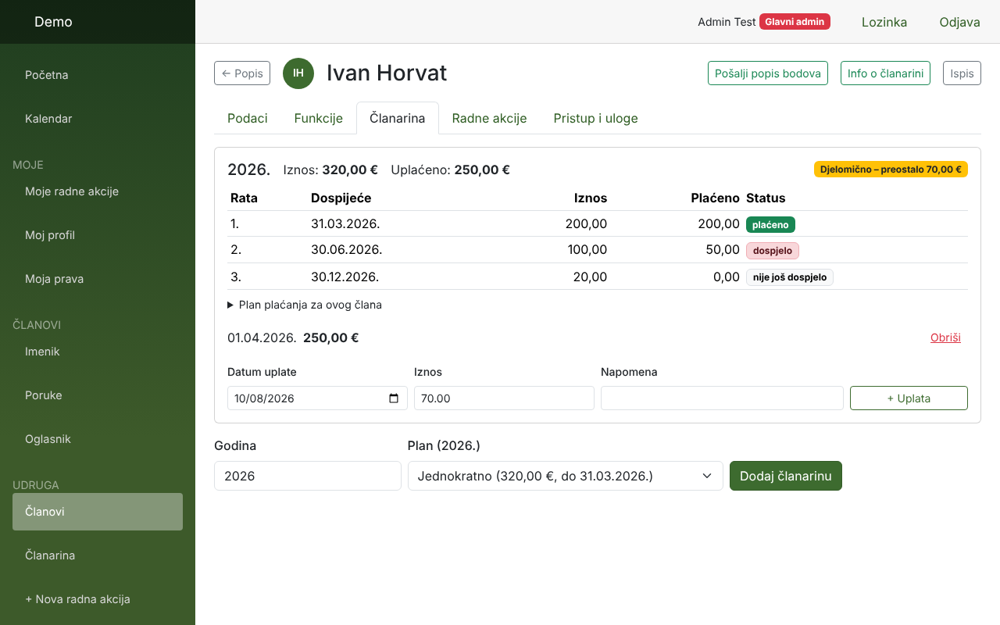
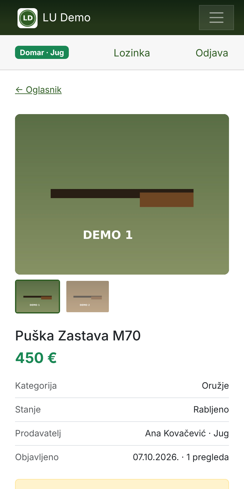

<p align="center">
  
</p>

<p align="center">
  <a href="https://evidencija.freedev.app"></a>
  <a href="../../releases/latest"></a>
  <a href="INSTALACIJA.md"></a>
</p>

<p align="center">
  
  
  
  
  
</p>

<h3 align="center">Članovi, članarina, dezinfekcija, lovište, čeke, dnevnik, oglasnik –<br>sve što lovačka udruga treba, u jednoj aplikaciji za računalo i mobitel.</h3>

---

## 🦌 Zašto ova aplikacija?

<table>
<tr>
<td width="33%" valign="top">

### 💚 Besplatno. Zauvijek.
Nema pretplate, nema licence po članu, nema skrivenih troškova. Privatni, nekomercijalni projekt – od lovca za lovce.

</td>
<td width="33%" valign="top">

### 🔒 Vaši podaci ostaju vaši
Aplikacija radi na **vašem** webhostingu. Nitko drugi – ni autor – nema pristup podacima vaše udruge.

</td>
<td width="33%" valign="top">

### 📱 Radi i u šumi
Na mobitelu se otvara kao aplikacija, bez trgovine aplikacija. Upis radi i **bez signala** – šalje se kad se vrati internet.

</td>
</tr>
</table>

---

## ✨ Što sve može

<table>
<tr>
<td width="50%" valign="top">

#### 👥 Članovi
Osobni i lovački podaci, fotografija, funkcije, iskaznica i ispit, arhiva bivših članova, uvoz iz Google kontakata, provjera duplikata.

#### 🗂️ Sekcije strogo odvojene
Svaka lovna jedinica vidi samo sebe. Uprava vidi sve.

#### 💶 Članarina i HUB-3 uplatnice
Jednokratno ili 1–12 rata s vlastitim iznosom i datumom. Član vidi samo svoju uplatnicu – ispis ili kod na mobitelu za banku. Diskretan podsjetnik kad rata dospije.

#### 🛠️ Radne akcije i bodovi
Voditelj upiše akciju jednom za sve, članovi prijavljuju sami s fotografijom, uprava odobrava. Izvještaji po lovnoj godini (1.4.–31.3.).

#### 🐕 Lovački psi
Pas uz lovca, bodovi za psa.

#### 📅 Kalendar
Termini za udrugu ili sekciju, „dolazim / ne dolazim“, pretplata u kalendar mobitela.

#### 🏡 Lovački domovi
Domovi udruge i sekcija na karti s navigacijom. Rezervacija po danima (privatno na odobrenje, događaj udruge ima prednost), kalendar zauzeća bez dvostrukih rezervacija, PDF plan.

</td>
<td width="50%" valign="top">

#### 🧴 Knjiga dezinfekcije (ASK)
QR oznaka na stanici svake sekcije, provjera GPS-a, dolazak/odlazak, reg. oznaka, suputnici i gosti. **Mobilna stanica** za skupni lov. Pristup za lovnog inspektora, PDF i e-pošta.

#### 🎯 Grupni lov – karta uživo i SOS
Poziv svima na mobitel („dolazim / ne dolazim“), položaj sudionika uživo na karti, upozorenje o gubitku signala, **SOS** organizatoru. Kraj lova briše sve položaje.
**📋 Popis sudionika:** lovnik skenira članske iskaznice (QR) i popis se slaže sam – i bez signala; ručni upis gostiju, PDF s potpisom.

#### 🪪 Članska iskaznica
Iskaznica s fotografijom i QR kodom u formatu bankovne kartice – PDF 10 na A4 ili za pisač kartica, i u aplikaciji (radi bez signala). Vrijedi dok je član aktivan; izgubljena se zamjenjuje novom.

#### 🔔 Push obavijesti
Obavijesti na mobitel i kad je aplikacija zatvorena: poruke, obavijesti udruge, radne akcije, kvarovi i zauzimanje čeka. Besplatno (Web Push), Android i iPhone (iOS 16.4+), svaki član bira što prima.

#### 🗺️ Lovište i čeke
Karta lovišta s granicama, lovne naprave s fotografijom, zauzimanje čeke jednim dodirom, gost na drugoj čeki, automatsko oslobađanje u 03:00, obavijest lovočuvarima. Prijava kvara na napravi s fotografijom (i „nesigurno – ne sjedati“), popis kvarova za obradu i PDF.

#### 📖 Lovački dnevnik
Tko je bio gdje i kada – po sekcijama.

#### 🛒 Oglasnik – od lovca za lovca
Kupujem / prodajem unutar udruge ili u **zajedničkom oglasniku lovaca** – samo za članove udruga, prijava preko vlastite aplikacije, bez vanjskih oglasa i spama.

#### 📢 Obavijesti s potvrdom čitanja
Uprava vidi tko je pročitao i kada. PDF kao dokaz.

#### 📦 Inventura · 📜 Statut i pravilnici · 💬 Poruke · 📇 Imenik
WhatsApp, Viber, SMS ili e-pošta – kako je članovima najlakše.

</td>
</tr>
</table>

---

## 📸 Kako izgleda

| Uprava (računalo) | Član (mobitel) |
|:---:|:---:|
|  |  |
|  |  |
|  |  |

> 👉 Najbolje je isprobati: **[demo verzija](https://evidencija.freedev.app)** s izmišljenim podacima.

---

## 🚀 Instalacija u 3 koraka

1. **Preuzmite** ZIP s [Releases](../../releases/latest) (ili *Code → Download ZIP*).
2. **Učitajte** sve preko FTP-a (npr. FileZilla) na bilo koji PHP webhosting.
3. **Otvorite** adresu u pregledniku → upišite naziv udruge, sekcije i administratora. Gotovo.

> 💡 **Još lakše:** učitajte samo [`instaliraj.php`](instaliraj.php) i otvorite ga – sam preuzme i postavi aplikaciju.

Nove verzije: administrator dobije obavijest i ažurira **jednim klikom**.
Detaljne upute: **[INSTALACIJA.md](INSTALACIJA.md)**

<details>
<summary><b>Zahtjevi za poslužitelj</b></summary>

- PHP **8.1+** s `pdo_sqlite`, `mbstring`, `openssl`, `dom`, `zip` (gotovo svaki hosting)
- preporučeno `gd` i `intl`
- Apache (`.htaccess`) ili nginx
- **Nije** potrebna MySQL baza – sve je u jednoj SQLite datoteci

</details>

<details>
<summary><b>Zaštita podataka na nginxu</b></summary>

Mapa `podaci/` sadrži osobne podatke. Na Apacheu je zaštićena automatski. Na nginxu dodajte:
```nginx
location ~ ^/evidencija/(app|podaci|vendor)/ { deny all; }
```
ili premjestite podatke izvan javne mape (`config.example.php` → `config.php`, `'podaci' => '/putanja/izvan/weba'`).
Aplikacija sama upozorava ako je baza javno dostupna.

</details>

<details>
<summary><b>Lokalno na računalu (bez hostinga)</b></summary>

```
php -S localhost:8080 ruter.php
```
i otvorite http://localhost:8080

</details>

<details>
<summary><b>Sigurnost</b></summary>

- pristup samo uz pozivnicu ili samoprijavu – uvijek uz odobrenje administratora
- dvofaktorska prijava (Google Authenticator) za administratore
- lozinke šifrirane, zaključavanje nakon 5 pogrešnih pokušaja, zaštita od CSRF-a
- automatske dnevne sigurnosne kopije, kompletna kopija (ZIP) za preseljenje
- dnevnik promjena – tko je što promijenio

</details>

---

## ❓ Česta pitanja

<details>
<summary><b>Je li stvarno besplatno? Gdje je kvaka?</b></summary>

Nema kvake. Ovo je privatni, nekomercijalni projekt. Softver je i ostat će besplatan – bez pretplate, bez naplate po članu, bez plaćenih dodataka.
</details>

<details>
<summary><b>Tko vidi podatke naše udruge?</b></summary>

Samo vi. Aplikacija radi na vašem serveru, podaci se nikamo ne šalju. Autor nema pristup.
</details>

<details>
<summary><b>Nismo informatičari. Možemo li to sami?</b></summary>

Ako znate učitati datoteke preko FTP-a – da. Upute su na hrvatskom, korak po korak. Za sve ostalo otvorite pitanje pod <a href="../../issues">Issues</a>.
</details>

<details>
<summary><b>Treba li aplikacija iz Google Playa ili App Storea?</b></summary>

Ne. Na mobitelu u pregledniku odaberite „Dodaj na početni zaslon“ – izgleda i radi kao aplikacija, na Androidu i iPhoneu.
</details>

---

## 🧑‍💻 Za programere

- bez frameworka: `index.php` → `app/stranice/<stranica>.php`, pomoćne funkcije u `app/lib/`, predlošci u `app/predlosci/`
- baza: `app/shema.sql` · ovisnosti (Composer): PHPMailer, Dompdf – `vendor/` je u repozitoriju zbog FTP instalacije
- pull requestovi su dobrodošli · promjene: [CHANGELOG.md](CHANGELOG.md)

---

## ⚖️ Licenca i odgovornost

[AGPL-3.0](LICENSE) © Darko Bakić – slobodno za korištenje, mijenjanje i dijeljenje. Izmijenjene verzije moraju ostati otvorene i besplatno dostupne pod istom licencom, i kad se nude kao online usluga. Verzije objavljene prije 1.24.0 bile su pod licencom MIT.

Naziv „Lovačka evidencija“ i logo nisu dio licence – izmijenjene verzije moraju koristiti drugi naziv i logo.

Privatni, nekomercijalni open-source projekt. Softver se daje besplatno i „kakav jest“, bez ikakvog jamstva.
Svaka udruga koja ga instalira sama je odgovorna za svoj server, podatke i zakonitu obradu osobnih podataka svojih članova (GDPR).

## 💬 Pomoć

- 🐞 Greške i prijedlozi: [Issues](../../issues)
- U programu: **Program → Upute za korištenje** i **Pomoć i kontakt**

<details>
<summary>🇩🇪 Deutsch · 🇬🇧 English</summary>

**DE:** Kostenlose Mitgliederverwaltung für Jagdvereine – Mitglieder, Beiträge, Desinfektionsbuch, Revierkarte, Kanzelbelegung, Jagdtagebuch, Kleinanzeigen. PHP 8.1+, SQLite, per FTP auf jeden Webspace. Oberfläche auf Kroatisch. Privates, nicht-kommerzielles Projekt.

**EN:** Free management app for hunting associations – members, fees, disinfection log, hunting ground map, stand booking, hunting diary, classifieds. PHP 8.1+, SQLite, upload via FTP to any web host. UI in Croatian. Private, non-commercial project.
</details>

<p align="center"><sub>Napravljeno s 💚 za lovce · od lovca za lovce</sub></p>
